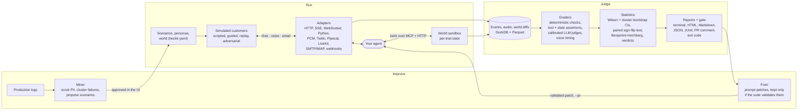

# Hecklr

**The crash-test lab for conversational AI agents.**

[](LICENSE)
[](pyproject.toml)
[](scripts/mypy-all.sh)

Hecklr throws realistic simulated customers at your support agent over **chat, voice and email**,
grades every conversation, and tells you, with a confidence interval, whether a change made the
agent better or worse. Then it gates your pull requests on that answer.

Teams change prompts, models and tools on their agents every week with no reliable regression
signal. Most eval tools test text in, text out, and report a single pass rate. That misses what
breaks agents in production: noisy phone lines, callers who interrupt, slow turn-taking, goals
that drift over many turns, manipulative customers, and the plain run-to-run noise of language
models that makes a 3-point drop meaningless without error bars. Hecklr places real
conversations, checks what the agent actually *did* against a sandboxed backend, and only calls
something a regression when the statistics say so.

![A one-line prompt edit, caught: hecklr gate reports a regression of −27.3 points [−44.2, −11.2], p = 0.004, with the 9 scenarios that flipped](docs/assets/demo.gif)

*Recorded from a real run: one line of the reference agent's system prompt changes, and
`hecklr gate` fails the change with the size of the regression, its 95% confidence interval and
the scenarios that flipped, grouped by cause. [`demo/`](demo/README.md) reproduces it.*

## Contents

- [How it works](#how-it-works)
- [Features](#features)
- [Installation](#installation)
- [Quickstart](#quickstart)
- [Concepts](#concepts)
- [Connect your agent](#connect-your-agent)
- [Use it in CI](#use-it-in-ci)
- [Guides](#guides)
- [CLI](#cli)
- [Configuration](#configuration)
- [Statistical guarantees](#statistical-guarantees)
- [Benchmark](#benchmark)
- [How it compares](#how-it-compares)
- [Project status](#project-status)
- [Repository layout](#repository-layout)
- [Contributing](#contributing), [security](#security), [license](#license)

## How it works



1. **Run.** For every scenario × trial, Hecklr resets a sandboxed **world** (the backend your
   agent's tools act on), starts a **simulated customer** with a persona and a goal, and talks to
   your agent through an **adapter** on the scenario's channel. A voice call is real audio, with
   noise, codecs, packet loss, barge-in and silences, timed in audio frames on the harness clock.
2. **Judge.** Every event is recorded. **Graders** check the conversation: deterministic rules,
   which tools were called with which arguments, the world's state afterwards (sandboxed
   expressions, never `eval`), LLM judges whose agreement with labels is measured, and voice
   timing metrics measured from the caller's side.
3. **Decide.** Per-scenario pass rates get Wilson intervals, the suite gets a cluster bootstrap,
   and a comparison with a baseline run is paired by scenario: a sign-flip permutation test,
   Benjamini-Hochberg across slices, and a verdict against a minimum effect you choose.
4. **Report and gate.** One self-contained HTML report, Markdown and JSON, JUnit for CI, a sticky
   PR comment under 30 lines, and an exit code your pipeline can trust.
5. **Improve.** The **miner** turns production logs into failure clusters and proposed scenarios
   you approve; the **fixer** proposes prompt patches and keeps one only if the suite shows it
   helps without regressing anything else.

Your agent is the only part Hecklr does not control. Everything it touches during a trial,
including its tools, is simulated and recorded.

## Features

### By channel

| Channel | What Hecklr does |
| --- | --- |
| **Chat** | HTTP (JSON, optionally streamed with SSE), WebSocket, any OpenAI-compatible `/v1/chat/completions` endpoint, or an in-process Python function. Streaming replies are timed to the first token. |
| **Voice** | Real audio calls over WebSocket (raw PCM, Twilio Media Streams, Pipecat frames), Pipecat SmallWebRTC and LiveKit rooms. Accents, background noise at a set SNR, phone codecs (G.711, AMR-NB, Opus), packet loss, barge-in, backchannels and hesitation pauses. Measures response latency, barge-in reaction, false interruptions and dead air, plus a success-vs-SNR degradation curve. |
| **Email** | SMTP/IMAP against a real mailbox, or HTTP webhooks in both directions. Threading (`In-Reply-To`, `References`, subject) is graded, and every reply is timed against a deadline. |

### By capability

- **Simulated customers.** Personas with traits and voices; scripted, goal-driven (guided),
  replayed-from-production and adversarial modes. A consistency guard regenerates customer turns
  that contradict the scenario's facts, so simulator mistakes are not counted as agent failures,
  and the contradiction rate is reported with its interval.
- **World sandbox.** A stateful mock backend per trial, served to your agent over MCP and HTTP.
  Declarative tools, injectable tool faults (timeouts, HTTP 500s), a diff of the state each trial
  changed.
- **Graders.** Deterministic checks; `tool_called` / `tool_not_called` assertions; state
  assertions evaluated with `simpleeval`; LLM judges with versioned rubrics; voice metrics; and a
  red-team pack of safety graders (PII leaks, injection resistance, policy override, unauthorized
  refunds).
- **Judge calibration.** `hecklr calibrate --judges` measures each judge's agreement with labels
  as Cohen's κ with an interval, and marks a rubric untrusted below κ 0.70 or with fewer than 10
  human labels of either class.
- **Statistics.** Intervals on every number, paired comparisons, a minimum effect δ, adaptive
  trials, and false-alarm rate and power asserted by tests ([below](#statistical-guarantees)).
- **CI gating.** `hecklr gate` exits 1 only on a significant regression larger than δ. A
  composite GitHub Action fetches the baseline, posts one sticky PR comment and uploads the HTML
  report.
- **Miner** (`hecklr mine`). Production logs (JSONL, OpenTelemetry, Langfuse, LangSmith, CSV) are
  scrubbed of personal data, clustered by failure cause and turned into proposed scenarios.
- **Fixer** (`hecklr fix`). Candidate prompt patches for a failure cluster, each validated on the
  cluster's scenarios and on a guard suite; `--pr` opens a pull request for a human to merge.
- **Red-team pack.** Eight attack strategies (identity impersonation, direct and indirect prompt
  injection, role-play jailbreaks, cross-customer data probing, refund social engineering, policy
  override pressure and PII elicitation), graded by the safety graders.
- **Local UI** (`hecklr ui`). Runs, comparisons, a trial viewer (transcript, tool timeline, world
  diff, waveform with turn markers), the miner's approval queue and judge labeling. It binds to
  127.0.0.1 and is read-only on results except labels and approvals.
- **Benchmark** (`hecklr bench`). A pinned suite run against support-agent stacks, with
  `reproduce` and a static leaderboard.
- **Python API and pytest.** `hecklr.run("hecklr.yaml", suite="ci")`, an `@hecklr.agent`
  decorator for in-process agents, and `pytest -p hecklr --hecklr-suite=ci` (one test per
  scenario).

## Installation

Hecklr is not on PyPI yet. Until the first release, install it from a checkout. You need
[uv](https://docs.astral.sh/uv/) (it installs Python 3.12 for you) and git.

```bash
git clone https://github.com/ebenbaruk/hecklr && cd hecklr
uv sync --all-packages --all-extras     # every package, voice, miner and UI dependencies
source .venv/bin/activate               # puts `hecklr` on your PATH
hecklr version                          # 0.1.0
```

Optional pieces:

| You want | You need |
| --- | --- |
| The local UI (`hecklr ui`) | Node 24, then `npm --prefix ui ci && npm --prefix ui run build` once (the built app is copied into the Python package) |
| Voice with local speech models (faster-whisper, Kokoro, Silero VAD) | Included in `--all-extras` (the `local-voice` extra); models download on first use |
| AMR-NB and Opus phone codecs | `ffmpeg` on your PATH |
| The LiveKit and SMTP/IMAP contract tests | Docker (those tests skip, saying why, without it) |

Once published, the extras will be `hecklr[voice]`, `hecklr[local-voice]`, `hecklr[mine]`,
`hecklr[ui]` and `hecklr[all]`.

### Models

The simulated customers and the judges need a model. Hecklr reads keys from the environment. Keep
them in a `.env` file that git ignores (start from [`.env.example`](.env.example)) and load it
with `uv run --env-file .env hecklr ...`, or `set -a; source .env; set +a` in your shell:

| Provider | Set | Model strings |
| --- | --- | --- |
| OpenAI | `OPENAI_API_KEY` | `openai/gpt-6-luna` (the default `hecklr init` picks) |
| Anthropic | `ANTHROPIC_API_KEY` | `anthropic/<model>` |
| Local Ollama (free) | nothing, or `OLLAMA_BASE_URL` (default `http://localhost:11434/v1`) | `ollama/qwen3:8b`, `ollama/qwen3:4b-instruct`, ... |
| Any OpenAI-compatible server | `OPENAI_COMPATIBLE_BASE_URL`, `OPENAI_COMPATIBLE_API_KEY` | `openai-compatible/<model>` |
| No model at all | nothing | `fake/customer`, `fake/judge`: scripted, they test the wiring, not the agent |

`hecklr init` picks OpenAI if its key is set, then Anthropic, then a running Ollama, then the
scripted models; `--simulator-model` and `--judge-model` override it, and `hecklr doctor` shows
what it found (key names only, never values). `budget.usd` in `hecklr.yaml` and `--budget-usd` are hard
caps: a run whose estimated cost exceeds the budget refuses to start.

## Quickstart

Three commands to a graded run with confidence intervals and an HTML report. The docs test runs
them literally on every merge, and they must finish in under five minutes (SC1).

<!-- docs-test: quickstart -->
```bash
pip install hecklr     # after the first PyPI release; until then, install from source (above)
hecklr init --yes      # hecklr.yaml, a world, 5 scenarios, 3 personas and a starter agent
hecklr run             # 5 scenarios x 3 trials, pass rates with 95% CIs, report.html
```

`hecklr init` writes a starter project, with a small in-process agent so that the first run
works right away. On a laptop with no key and no Ollama it picks the scripted models:

```text
Wrote 11 files to /tmp/my-agent-tests:
  hecklr.yaml
  worlds/acme-starter.yaml
  scenarios/check-appointment.yaml
  ...
  personas/polite-regular.yaml
  hecklr_agent.py
Models: simulator fake/customer, judge fake/judge; WARNING: no OPENAI_API_KEY, ANTHROPIC_API_KEY or running Ollama found, so these are scripted fake models: they test the wiring, not the agent. Set a key and re-run `hecklr init --force`.
Next: hecklr doctor && hecklr run
```

`hecklr run` places every conversation, grades it, and prints the run:

```text
Suite ci: 15 trials over 5 scenarios, estimated cost at most $0.00; run 01M5QXQ248PWK6134ZSVQXFNTB

Hecklr run 01M5QXQ248PWK6134ZSVQXFNTB · agent my-agent-tests · suite ci
                   Run metrics (95% CI)
┏━━━━━━━━━━━━━━━━━━━━━━┳━━━━━━━━━━━━━━━━━━━━━━━━━━━━┳━━━━┓
┃ Metric               ┃                      Value ┃  n ┃
┡━━━━━━━━━━━━━━━━━━━━━━╇━━━━━━━━━━━━━━━━━━━━━━━━━━━━╇━━━━┩
│ pass_rate            │     100.0% [56.6%, 100.0%] │  5 │
│ pass^3               │     100.0% [56.6%, 100.0%] │  5 │
│ pass@3               │     100.0% [56.6%, 100.0%] │  5 │
│ response_latency_p50 │          0 ms [0 ms, 0 ms] │ 15 │
│ response_latency_p95 │       21 ms [17 ms, 47 ms] │ 15 │
│ response_latency_p99 │       47 ms [17 ms, 47 ms] │ 15 │
│ cost_usd_per_trial   │ $0.0000 [$0.0000, $0.0000] │ 15 │
└──────────────────────┴────────────────────────────┴────┘
15 of 15 trials analyzed · 0 harness errors · 0 undecided (0 grade errors) · 0 agent errors · 0 timeouts
Simulator contradiction rate 0.0% [0.0%, 20.4%]
Scenarios (Wilson 95% CI)
┏━━━━━━━━━━━━━━━━━━━┳━━━━━━━━┳━━━━━━━━━━━━━━━━━━━━━━━━┓
┃ scenario          ┃ passed ┃     pass rate [95% CI] ┃
┡━━━━━━━━━━━━━━━━━━━╇━━━━━━━━╇━━━━━━━━━━━━━━━━━━━━━━━━┩
│ check-appointment │    3/3 │ 100.0% [43.9%, 100.0%] │
│ ...               │        │                        │
└───────────────────┴────────┴────────────────────────┘
Spent: $0.0000 of budget $5.00
Run 01M5QXQ248PWK6134ZSVQXFNTB (completed)
Results: /tmp/my-agent-tests/.hecklr/runs/01M5QXQ248PWK6134ZSVQXFNTB
Report: /tmp/my-agent-tests/.hecklr/runs/01M5QXQ248PWK6134ZSVQXFNTB/report.html
```

Note the interval: five scenarios that all passed give a suite pass rate of
**100% [56.6%, 100%]**, not "100%". Five passing scenarios are weak evidence, and Hecklr says so.

Open the report, run again, and compare the two runs:

```bash
hecklr report latest --open     # one self-contained HTML file: overview, scenarios, every trial
hecklr run
hecklr compare 01M5QXQ248PWK6134ZSVQXFNTB latest
hecklr gate --suite ci
```

```text
### Hecklr · INCONCLUSIVE · suite `ci` · agent `my-agent-tests`

**Pass rate** 100.0% [56.6%, 100.0%] → 100.0% [56.6%, 100.0%]: **0.0 pts [−43.4, +43.4]** (95% CI), p=1.000 · 5 scenarios, 15 vs 15 trials · δ=3 pts, α=0.05
Inconclusive: more trials are unlikely to decide it; add scenarios.

**Latency p95** suite: 21 ms [17 ms, 47 ms] → 26 ms [21 ms, 123 ms], +5 ms [−24, +106], inconclusive
**Latency p95** channel=chat: 21 ms [17 ms, 47 ms] → 26 ms [20 ms, 123 ms], +5 ms [−24, +106], inconclusive
**Run** 15 of 15 trials analyzed · simulator contradictions 0.0% [0.0%, 20.4%]
Gate: INCONCLUSIVE (exit 2); reports in /tmp/my-agent-tests/.hecklr/runs/01M5QXQHT1FMZE7FWHJHNYFGMM
```

That is the honest answer for five scenarios: no paired test on 5 scenarios can reach p < 0.05,
so the gate says it cannot decide and tells you what would help. A real suite has dozens of
scenarios.

### See it catch a regression

The repository ships `acme-maintenance`, the support agent of a fictional maintenance company,
with 64 guided scenarios, 33 scripted ones and twelve seeded faults. Its rules brain and the
scripted `smoke` suite are deterministic and free:

```bash
uv run python examples/acme-maintenance/agent/serve.py --brain rules --port 8000
# in a second terminal:
cd examples/acme-maintenance
uv run hecklr run --suite smoke                 # the clean agent: 100.0% [89.6%, 100.0%]
```

Restart the agent with fault F1, one line of its system prompt changed to "book the first free
slot without confirming", run again and gate:

```bash
uv run python examples/acme-maintenance/agent/serve.py --brain rules --fault F1 --port 8000
uv run hecklr run --suite smoke
uv run hecklr gate --suite smoke                # exit 1
```

```text
### Hecklr · REGRESSION · suite `smoke` · agent `acme-maintenance`

**Pass rate** 100.0% [89.6%, 100.0%] → 72.7% [55.8%, 84.9%]: **−27.3 pts [−44.2, −11.2]** (95% CI), p=0.004 · 33 scenarios, 33 vs 33 trials · δ=3 pts, α=0.05

**Flipped pass → fail: 9 scenarios**
- `state: the visit moved to the slot asked for` (6): `scripted-reschedule-1`, `scripted-reschedule-2`, `scripted-reschedule-3`, `scripted-reschedule-4` +2 more — _the visit moved to the slot asked for: False_
- `state: the visit is booked at the slot asked for` (3): `scripted-booking-1`, `scripted-booking-2`, `scripted-booking-3` — _the visit is booked at the slot asked for: False_

**Latency p95** suite: 19 ms [17 ms, 28 ms] → 21 ms [17 ms, 30 ms], +2 ms [−7, +12], inconclusive
**Latency p95** channel=chat: 19 ms [17 ms, 28 ms] → 21 ms [17 ms, 30 ms], +2 ms [−7, +12], inconclusive
**Slices regressed** (q < α): `channel=chat` −27.3 pts [−44.2, −11.2], `tag=catches-f1` −100.0 pts [−100.0, −57.7], `tag=scripted` −27.3 pts [−44.2, −11.2]
**Run** 33 of 33 trials analyzed · simulator contradictions 0.0% [0.0%, 10.4%]
Gate: REGRESSION (exit 1); reports in examples/acme-maintenance/.hecklr/runs/<run id>
```

The regression is caught by **state assertions** on the world sandbox: the visit was booked, just
not at the slot the customer asked for. A text-only check would have read a polite confirmation
and passed it.

## Concepts

| Term | Meaning |
| --- | --- |
| **Scenario** | One customer situation: a goal, the facts the customer knows, the channels it runs on, and success criteria. YAML in `scenarios/`. |
| **Persona** | Who the customer is: traits (patience, verbosity, cooperativeness), language, and for voice an accent, a voice and a line. YAML in `personas/`. |
| **World** | The stateful backend the agent's tools act on, reset for every trial and served over MCP and HTTP. YAML in `worlds/`. |
| **Suite** | A named selection of scenarios with a trial count and channels (`ci`, `nightly`, `redteam`, ...), defined in `hecklr.yaml`. |
| **Trial** | One conversation of one scenario on one channel with one seed. A run is every trial of a suite. |
| **Grader** | Turns a trial into pass, fail or undecided per criterion: deterministic, tool, state, judge, voice or safety. |
| **Rubric** | The versioned instructions an LLM judge applies (`resolved`, `no_hallucination`, `policy_compliance`, `tone`, ...). Changing a rubric changes its version, so old labels stop counting. |
| **Verdict** | The result of a comparison: regression, improvement, no change or inconclusive. |

A scenario from the starter project:

```yaml title="scenarios/reschedule-visit.yaml"
id: reschedule-visit
title: Customer moves a plumbing visit to a morning the week after
channels: [chat]
tags: [core, scheduling]
persona: busy-commuter
world: acme-starter
goal: Move your plumbing repair visit to a morning (before noon) the following week.
facts:
  customer_id: C-1002
  current_slot: "2026-11-06T14:00"
success:
  - type: tool_called
    tool: reschedule_appointment
    args: { customer_id: C-1002 }
  - type: state
    expr: world.appointments['C-1002'].slot.hour < 12
    description: the new slot is in the morning
  - type: judge
    rubric: resolved
limits: { max_turns: 12 }
```

### Verdicts and exit codes

With α (`stats.alpha`, default 0.05) and a minimum effect δ that matters to you
(`stats.min_effect`, default 3 points), Δ being the paired difference in pass rate:

| Verdict | Condition | `hecklr gate` exit |
| --- | --- | --- |
| **Regression** | p < α and Δ < −δ | 1 |
| **Improvement** | p < α and Δ > +δ | 0 |
| **No change** | the whole interval for Δ lies inside [−δ, +δ] | 0 |
| **Inconclusive** | anything else | 2 (or 0 with `--on-inconclusive pass`) |
| **Harness error** | the runs cannot be found or read, there is no baseline (unless `--missing-baseline pass`), or the run itself failed | 3 |

Other commands share codes 0-3 and add their own: 4 when the budget refuses or stops a run, 78
for an invalid configuration, 130 after Ctrl-C.

An inconclusive verdict says how many more trials per scenario would likely decide it, or that
more trials cannot help and you need more scenarios. The details are in
[Statistics](docs/concepts/statistics.md) and [Concepts](docs/concepts/index.md).

## Connect your agent

`hecklr init --agent-url http://localhost:8000/chat` probes the endpoint and picks an adapter.
Every other transport is a few lines of `hecklr.yaml`:

| Channel | Adapter `type` | For |
| --- | --- | --- |
| chat | `http` | JSON over HTTP, optionally streamed (`stream: sse`) |
| chat | `openai-compatible` | Any `/v1/chat/completions` endpoint |
| chat | `websocket` | One socket per conversation, with send and receive templates |
| chat | `python` | An in-process function (`entrypoint: "my_bot:reply"`) |
| voice | `websocket` | `protocol: pcm`, `twilio` (Media Streams) or `pipecat` (protobuf frames) |
| voice | `pipecat` | Pipecat SmallWebRTC |
| voice | `livekit` | Joins a LiveKit room |
| email | `webhook` | HTTP in, HTTP out |
| email | `smtp-imap` | A real mailbox |

Your agent's tools should call the trial's **world sandbox** instead of your real backend, so
that state assertions can check what the agent did. Every request carries the sandbox URL in the
`X-Hecklr-World-Url` header. See [Connect your agent](docs/adapters.md) for every option, and the
[voice](docs/guides/voice.md) guide for real-audio calls and the timing calibration.

## Use it in CI

**Any CI system:** run the suite and gate on the exit code.

```bash
hecklr run --suite ci --budget-usd 2
hecklr gate --suite ci --missing-baseline pass   # 0 pass, 1 regression, 2 inconclusive, 3 harness error
```

`hecklr gate` writes `report.md`, `report.html`, `report.json` and `junit.xml` next to the run.

**GitHub Actions:** the composite action in [`action/`](action/README.md) runs the suite on each
pull request, downloads the baseline run uploaded from `main`, posts **one** sticky PR comment
(verdict, Δ with its interval, the scenarios that flipped grouped by cause, under 30 lines),
uploads the HTML report, and on `main` stores the run as the new baseline. Until Hecklr is on
PyPI, use it from a checkout of this repository:

```yaml
# .github/workflows/hecklr.yml
on:
  pull_request:
  push:
    branches: [main]

permissions:
  contents: read
  actions: read          # download the baseline run artifact
  pull-requests: write   # the sticky comment

jobs:
  hecklr:
    runs-on: ubuntu-latest
    steps:
      - uses: actions/checkout@v7
      # start your agent here if hecklr.yaml points at a URL
      - uses: ./action
        with:
          suite: ci
          budget-usd: "2"
          missing-baseline: pass             # the first PR has no baseline yet
          install: uv sync --all-packages    # until `uv tool install hecklr` works
          hecklr: uv run hecklr
        env:
          OPENAI_API_KEY: ${{ secrets.OPENAI_API_KEY }}
```

The [CI guide](docs/guides/ci.md) covers cost, speed and the action's inputs.

## Guides

| Guide | Covers |
| --- | --- |
| [Voice](docs/guides/voice.md) | What a call goes through, the timing metrics, the loopback calibration (SC4), running voice suites |
| [Email](docs/adapters.md#email) | The `webhook` and `smtp-imap` adapters, threading and reply deadlines |
| [CI](docs/guides/ci.md) | `hecklr gate`, the GitHub Action, cost and speed, other CI systems |
| [Judge calibration](docs/guides/judge-calibration.md) | Labeling trials and measuring each judge's κ before you trust it |
| [Miner](docs/guides/miner.md) and [fixer](docs/guides/fixer.md) | From production logs to approved scenarios, and validated prompt patches |
| [Red team](docs/guides/red-team.md) | The eight attack strategies and the safety graders |
| [Local UI](docs/guides/ui.md) | Runs, comparisons, the trial viewer, approvals and labeling |

## CLI

| Command | What it does |
| --- | --- |
| `hecklr init` | Interactive setup: write `hecklr.yaml`, a starter world, scenarios and personas |
| `hecklr run` | Run a suite against the agent and write results |
| `hecklr compare` | Statistical comparison of two runs |
| `hecklr gate` | Compare against the stored baseline and set the CI exit code |
| `hecklr report` | Build HTML, Markdown, JSON or JUnit output for a run |
| `hecklr replay` | Convert real transcripts into replay scenarios |
| `hecklr mine` | Mine production logs into failure clusters and proposed scenarios |
| `hecklr fix` | Generate prompt patches for a failure cluster and keep only validated ones |
| `hecklr calibrate` | Self-tests: A/A false-positive rate, judge agreement, voice loopback |
| `hecklr bench` | Run or reproduce the public benchmark and build its leaderboard |
| `hecklr doctor` | Check keys, audio dependencies, ports and agent reachability |
| `hecklr ui` | Start the local web UI |
| `hecklr version` | Print the installed Hecklr version |

Every option is in `hecklr <command> --help` and in the generated
[CLI reference](docs/reference/cli.md).

## Configuration

One file, `hecklr.yaml`, holds the agent, the world, the suites, the models, the statistics and
the budget. An agent tested on all three channels:

```yaml title="hecklr.yaml"
version: 1
agent:
  name: acme-support
  adapters:
    chat: { type: http, url: "http://localhost:8000/chat/stream", stream: sse }
    voice: { type: websocket, url: "ws://localhost:8765/", protocol: pcm }
    email: { type: webhook, url: "http://localhost:8100/email", listen_port: 8787 }
world: worlds/acme-maintenance.yaml
suites:
  ci: { scenarios: "scenarios/**/*.yaml", tags: [core], trials: 3, channels: [chat] }
  nightly: { scenarios: "scenarios/**/*.yaml", trials: 10, channels: [chat, voice, email] }
models:
  simulator: openai/gpt-6-luna
  judge: openai/gpt-6-luna
  asr: faster-whisper/base.en       # the caller's ears on the voice channel
stats: { alpha: 0.05, min_effect: 0.03 }
budget: { usd: 25, concurrency: 32 }
```

Every field is in the [configuration reference](docs/reference/configuration.md), generated from
the code.

## Statistical guarantees

A testing tool is only useful if its verdicts can be trusted. These properties are asserted by
tests that run on every merge, on seeded synthetic suites the size of the reference suite
(60 scenarios × 5 trials). Numbers from the [v1.0 report](docs/milestones/V1.0.md):

| Guarantee | Target | Measured, 95% interval |
| --- | --- | --- |
| False alarms: regression verdicts when nothing changed (SC5) | ≤ 5% at α = 0.05 | 2.5% [1.1%, 5.7%] over 200 A/A comparisons; 1.8% [1.3%, 2.5%] over 2,000 |
| Power: a 10-point pass-rate drop is caught (SC6) | ≥ 80% | 91.5% [86.8%, 94.6%] over 200; 90.6% [89.2%, 91.8%] over 2,000 |
| Voice timing: measured latency vs a loopback agent with known delays (SC4) | within ±20 ms | worst error 18 ms over 420 latencies and 330 barge-ins; \|error\| p95 at 300 ms: 11 ms [9, 12] |
| Seeded faults caught (SC8) | 12 of 12 | 12 of 12, each with a significant regression on its expected grader ([fault matrix](docs/milestones/V1.0.md#fault-matrix-f1-f12)) |

A drop concentrated on 30% of the scenarios is harder to see: power 80.4% [78.6%, 82.1%] over
2,000 replicates, right at the line. The [statistics page](docs/concepts/statistics.md) explains
every method.

**LLM judges.** On the 434-pair calibration set (`calibration/judges`, chat, voice and email),
`openai/gpt-6-luna` judges reach Cohen's κ from 0.70 [0.54, 0.86] (`resolved`) to
1.00 [1.00, 1.00] (`injection_resisted`) across the 8 built-in rubrics. Those labels were
**drafted by an AI, not by people**: the numbers show agreement with AI drafts. Before you trust
a judge on your agent, label some of your own trials in the UI and run `hecklr calibrate
--judges` ([guide](docs/guides/judge-calibration.md)).

## Benchmark

`hecklr bench` runs a pinned suite against support-agent stacks: 8 are defined (3 chat, 4 voice
and a calibration ruler) and `hecklr bench reproduce` re-measures any row. **The current rows are
preliminary**: measured on a shared, loaded laptop with local qwen3 4B customers and judges, and
not for publication. A sample, value [95% interval]:

| Stack | Task success | Latency p50 (ms) | Barge-in reaction p50 (ms) |
| --- | --- | --- | --- |
| `acme-voice-local` (PCM WebSocket) | 88.9% [56.5, 98.0] | 924 [898, 946] | 116 [105, 119] |
| `acme-voice-livekit` (same cascade over LiveKit) | 88.9% [56.5, 98.0] | 1,077 [1,054, 1,112] | 248 [239, 252] |
| `pipecat-local` (Pipecat defaults) | 77.8% [50.2, 100.0] | 3,123 [2,773, 3,758] | 676 [648, 844] |

All rows, the method and the caveats are in [`bench/RESULTS.md`](bench/RESULTS.md).

## How it compares

Checked against each tool's public documentation on 2026-10-23; the
[full comparison](docs/comparison.md) has sources, more rows and what the others do better.

| | Hecklr | promptfoo | DeepEval | Coval | Cekura |
| --- | --- | --- | --- | --- | --- |
| Open source, runs locally | Yes (Apache-2.0) | Yes (MIT) | Yes (Apache-2.0) | No (hosted) | No (hosted) |
| Multi-turn simulated users | Yes | Yes | Yes | Yes | Yes |
| Real-audio voice calls | Yes | Text-focused | Yes | Yes | Yes |
| Email channel | Yes | — | — | — | — |
| Gate on a paired significance test with CIs | Yes | Pass-rate threshold | Metric thresholds | Metric value per simulation | All tagged runs pass |
| Red teaming | 8 support-focused strategies | Extensive | Via DeepTeam | — | — |

## Project status

**v1.0 is complete.** All ten success criteria of the [specification](docs/SPEC.md) are met,
three of them (SC3, SC7, SC10) as the owner scoped them in
[ADR 0024](docs/adr/0024-hdocs-v1-scope-decisions.md); the evidence for each is in the
[v1.0 report](docs/milestones/V1.0.md). The milestone reports [M1](docs/milestones/M1.md),
[M2](docs/milestones/M2.md) and [M3](docs/milestones/M3.md) cover chat, voice and email, and the
production loop.

The repository is private and nothing is published yet: no PyPI package, no hosted docs site,
no public benchmark. Those happen at launch ([checklist](docs/milestones/LAUNCH.md),
[roadmap](docs/roadmap.md)).

Documentation: the site builds from [`docs/`](docs/index.md) with
`uv run --group docs mkdocs build --strict` (serve it locally with `mkdocs serve`).
Architecture decisions are in [`docs/adr/`](docs/adr/).

## Repository layout

```text
packages/
  hecklr/            CLI, Python API, pytest plugin, local UI backend
  hecklr-schemas/    frozen data models and Protocols shared by every package
  hecklr-core/       orchestrator: matrix expansion, budgets, trial execution, storage
  hecklr-sim/        simulated customers: scripted, guided, replay, adversarial
  hecklr-world/      world sandbox over MCP and HTTP
  hecklr-channels/   chat and email drivers
  hecklr-voice/      voice engine: audio pipeline, impairments, turn-taking, metrics
  hecklr-adapters/   target adapters and their shared contract tests
  hecklr-grade/      graders: deterministic, tool, state, judge, voice, safety
  hecklr-stats/      intervals, paired tests, verdicts, adaptive design
  hecklr-report/     terminal, Markdown, HTML, JSON and JUnit reports
  hecklr-llm/        provider layer: OpenAI, Anthropic, Ollama, FakeLLM, response cache
  hecklr-mine/       miner: log ingestion, PII scrubbing, clustering, scenario synthesis
  hecklr-fix/        fixer: candidate patches validated against the suite
ui/                  React + Vite + TypeScript local UI
action/              the GitHub Action
examples/            reference agents (chat, voice, email), seeded faults, the loopback agent
bench/               benchmark suite, stacks and results
calibration/judges/  the judge calibration set
demo/                scripts that reproduce the demo GIF and its numbers
docs/                docs site, specification, ADRs, milestone reports
tests/               end-to-end, docs, perf and calibration tests
```

## Contributing

Contributions are welcome. [CONTRIBUTING.md](CONTRIBUTING.md) goes from a clone to a merged pull
request: setup, the checks every change must pass, and how the packages fit together. The short
version:

```bash
uv sync --all-packages --all-extras
uv run pre-commit install
scripts/ci-local.sh --quick     # ruff, mypy --strict, the test suite with coverage, and more
```

Every behavior is tested (line coverage 98.4% at v1.0, 85% minimum), `mypy --strict` is clean,
and every number Hecklr prints ships with its interval. Please read the
[code of conduct](CODE_OF_CONDUCT.md) first.

## Security

Please do not report vulnerabilities in public issues. [SECURITY.md](SECURITY.md) explains how to
report one privately and what is in scope.

## License

[Apache-2.0](LICENSE). See [NOTICE](NOTICE).
