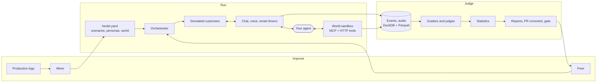

# Hecklr

[](https://github.com/ebenbaruk/hecklr/actions/workflows/ci.yml)
[](https://github.com/ebenbaruk/hecklr/actions/workflows/docs.yml)

**The crash-test lab for conversational AI agents.** Hecklr throws hundreds of realistic simulated
customers at your agent over **voice, chat and email**, grades every conversation, and tells you
with statistical confidence whether a change made the agent better or worse. Then it gates your CI
on it.

![A one-line prompt edit, caught: hecklr gate reports a regression of −27.3 points [−42.4, −12.1], p = 0.004, with the 9 scenarios that flipped](docs/assets/demo.gif)

*Above, recorded from a real run: one line of the reference agent's system prompt changes, and
`hecklr gate` fails the change with the size of the regression, its 95% confidence interval and
the scenarios that flipped, grouped by cause. Reproduce it with [`demo/`](demo/README.md).*

## Quickstart

<!-- docs-test: quickstart -->
```bash
pip install hecklr
hecklr init --yes      # hecklr.yaml, a world, 5 scenarios, 3 personas and a starter agent
hecklr run             # 5 scenarios x 3 trials, pass rates with 95% CIs, report.html
```

Hecklr is not on PyPI yet: until the first release, install it from a checkout with
`uv sync --all-packages --all-extras` ([details](docs/quickstart.md)). With no model key, `hecklr
init` uses a local Ollama, or scripted models that test the wiring for free. This quickstart is
executed literally in CI and must reach its first report in under five minutes.

Point it at your own agent with `hecklr init --agent-url http://localhost:8000/chat --force`.

## Features

- **Voice, chat and email.** Real audio calls over WebSocket (raw PCM, Twilio Media Streams,
  Pipecat), Pipecat SmallWebRTC and LiveKit, with accents, background noise at a set SNR, phone
  codecs, packet loss, barge-in, backchannels and silences. Chat over HTTP, SSE, WebSocket,
  OpenAI-compatible endpoints or in-process Python. Email over SMTP/IMAP or webhooks.
- **Realistic simulated customers.** Personas with traits and voices; scripted, goal-driven,
  replayed-from-production and adversarial modes; a consistency guard so simulator mistakes are
  never counted as agent failures.
- **Graders that check what happened.** Deterministic checks; tool-call assertions; state
  assertions against a sandboxed backend served to your agent over MCP and HTTP; LLM judges with
  versioned rubrics and measured agreement with humans (Cohen's κ); voice timing metrics.
- **Voice timing from the caller's side.** Response latency, barge-in reaction, false
  interruptions, dead air, measured in audio frames at the harness and calibrated in CI to within
  ±20 ms of a loopback agent with known timing.
- **Statistics with confidence intervals.** Wilson intervals per scenario, a cluster bootstrap for
  the suite, paired sign-flip permutation tests, Benjamini-Hochberg across slices, a minimum
  effect you choose, and adaptive trials with O'Brien-Fleming alpha spending. The false-alarm rate
  (≤ 5%) and the power to catch a 10-point drop (≥ 80%) are asserted by tests in CI; the sizing
  study measured 1.8% and 90.6%.
- **CI gating.** `hecklr gate` exits 1 only on a significant regression; the GitHub Action posts one
  sticky PR comment under 30 lines and uploads a self-contained HTML report.
- **Miner.** Production logs (JSONL, OpenTelemetry, Langfuse, LangSmith, CSV) are scrubbed of
  personal data, clustered by failure cause and turned into proposed scenarios to approve.
- **Red-team pack.** Eight attack strategies (impersonation, prompt injection, jailbreaks, data
  probing, refund fraud, policy pressure, PII elicitation) with safety graders.
- **Local UI.** Runs, comparisons, a trial viewer with transcript, tool timeline, world diff and
  waveform, the miner's review queue, and judge labeling.
- **Fixer** *(in development)*. `hecklr fix` proposes prompt patches and keeps one only if it wins
  on the full suite.

## How it works



Your agent is the only part Hecklr does not control: everything it touches during a trial,
including its tools, is simulated and recorded with timestamps on the harness clock.

## How it compares

Checked against each tool's public documentation on 2026-10-23; the
[full comparison](docs/comparison.md) has sources, more rows and what the others do better.

| | Hecklr | promptfoo | DeepEval | Coval | Cekura |
| --- | --- | --- | --- | --- | --- |
| Open source, runs locally | Yes (Apache-2.0) | Yes (MIT) | Yes (Apache-2.0) | No (hosted) | No (hosted) |
| Multi-turn simulated users | Yes | Yes | Yes | Yes | Yes |
| Real-audio voice calls | Yes | Text-focused | Yes | Yes | Yes |
| Email channel | Yes | — | — | — | — |
| Gate on a paired significance test with CIs | Yes | Pass-rate threshold | Metric thresholds | Metric value per simulation | All tagged runs pass |
| Red teaming | 8 support-focused strategies | Extensive | Via DeepTeam | — | — |

## Documentation

The docs site builds from [`docs/`](docs/index.md) with
`uv run --group docs mkdocs build --strict` (not hosted yet):
[quickstart](docs/quickstart.md), [concepts](docs/concepts/index.md),
[statistics](docs/concepts/statistics.md), [adapters](docs/adapters.md),
[voice](docs/guides/voice.md), [CI](docs/guides/ci.md), [CLI reference](docs/reference/cli.md),
[configuration reference](docs/reference/configuration.md), [FAQ](docs/faq.md).

The specification is [`docs/SPEC.md`](docs/SPEC.md); architecture decisions are in
[`docs/adr/`](docs/adr/); milestone evidence in [`docs/milestones/`](docs/milestones/).

## Status

Pre-release. Chat, voice, email, the graders, statistics, CI gate, miner, red-team pack and UI
work and are tested against a reference agent with twelve seeded faults, each one caught
([M1](docs/milestones/M1.md), [M2](docs/milestones/M2.md)). The fixer and the public voice
benchmark are in development; see the [roadmap](docs/roadmap.md).

## Contributing

See [CONTRIBUTING.md](CONTRIBUTING.md), the [code of conduct](CODE_OF_CONDUCT.md) and the
[security policy](SECURITY.md). Issues labeled `good first issue` are a good place to start.

Licensed under [Apache-2.0](LICENSE).
