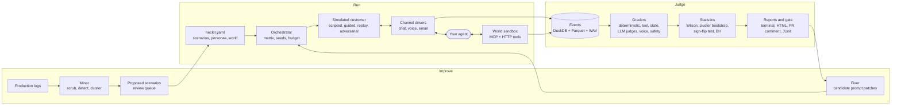

# Concepts

Hecklr has three stages. **Run** places real conversations against your agent, **Judge** turns
the recordings into a statistically sound verdict, and **Improve** turns production failures into
new tests and fixes. Your agent is the only part Hecklr does not control: everything it touches
during a trial, its tools included, is simulated and recorded.

## The run lifecycle

1. **Load.** Parse `hecklr.yaml`, the scenarios, personas and world; validate every file and fail
   fast with the file and line of the first problem.
2. **Plan.** Expand the trial matrix (scenario × persona × channel × trial index), derive a seed for
   every trial, estimate the cost, and refuse to start if the estimate exceeds the budget.
3. **Execute.** For each trial: give it a fresh copy of the world, open a session through the
   adapter, let the simulated customer and the agent converse, and record every event with a
   timestamp on the harness clock.
4. **Grade.** Deterministic graders first, then LLM judges (cached), then voice metrics.
5. **Aggregate.** Per-scenario and suite metrics, each with a confidence interval.
6. **Compare.** Pair with the baseline run by scenario, compute the change with its interval, the
   p- and q-values, and a verdict; with `--adaptive`, add trials where the answer is unclear.
7. **Gate and report.** Write the reports, set the exit code, post the PR comment.

## Pages

- [Scenarios, personas and worlds](scenarios.md): what you author.
- [Runs and trials](runs.md): what Hecklr produces, and how a run stays reproducible and in budget.
- [Graders and judges](graders.md): how a conversation becomes pass or fail, with evidence.
- [Statistics](statistics.md): the exact methods behind every interval and verdict.

## Invariants

These hold everywhere, and every number in a report depends on them:

- IDs are [ULIDs](https://github.com/ulid/spec): sortable by creation time.
- Times are integer milliseconds on the harness's monotonic clock; voice timings are measured in
  audio frames at the harness, never read from the agent's logs.
- A trial is reproducible from the configuration hash, its seed and the cached model responses.
  Every random choice takes an explicit seed.
- Artifacts are append-only: a run is never rewritten, only added to.
