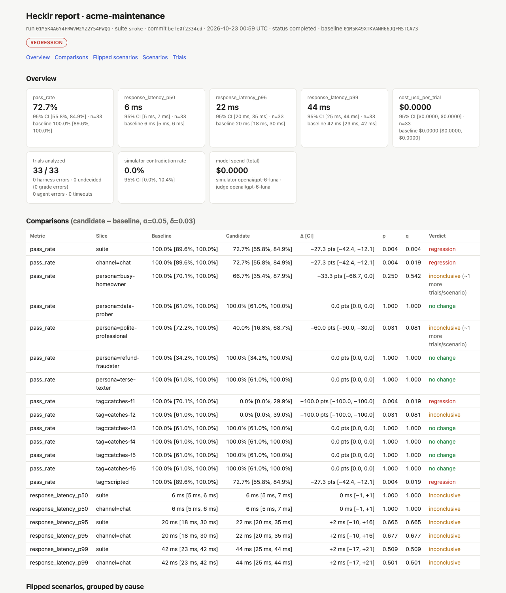

# CI and the GitHub Action

The point of testing an agent in CI is to block regressions without slowing the team down. A gate
that fails on noise gets ignored within a week, so Hecklr's gate fails a pull request only when
the regression is **statistically significant and larger than the minimum effect you set**
(`stats.min_effect`, default 3 points).

## `hecklr gate`

```bash
hecklr run --suite ci --baseline <baseline run id>
hecklr gate --suite ci
```

`hecklr gate` compares the latest run of the suite with its baseline (the run it recorded as
`--baseline`, else the newest earlier completed run of the same suite) and exits with:

| Exit | Meaning |
| --- | --- |
| 0 | pass: no change, an improvement, or (with `--on-inconclusive pass`) inconclusive |
| 1 | regression: p < α and Δ < −δ |
| 2 | inconclusive (configurable with `gate.on_inconclusive` or `--on-inconclusive`) |
| 3 | harness error: the runs could not be read or nothing could be analyzed |

It writes `report.md` (the PR comment), `report.html`, `report.json` and `junit.xml` (one test
case per scenario) to `--out-dir`. The Markdown stays under 30 lines: the verdict, Δ with its
interval, the scenarios that flipped from pass to fail grouped by the criterion that failed, latency
changes and the slices that regressed. A real one, from the [demo](https://github.com/ebenbaruk/hecklr/blob/main/demo/RESULTS.md):

```markdown
### Hecklr · REGRESSION · suite `smoke` · agent `acme-maintenance`

**Pass rate** 100.0% [89.6%, 100.0%] → 72.7% [55.8%, 84.9%]: **−27.3 pts [−42.4, −12.1]** (95% CI), p=0.004 · 33 scenarios, 33 vs 33 trials · δ=3 pts, α=0.05

**Flipped pass → fail: 9 scenarios**
- `state: the visit moved to the slot asked for` (6): `scripted-reschedule-1`, `scripted-reschedule-2`, `scripted-reschedule-3`, `scripted-reschedule-4` +2 more — _the visit moved to the slot asked for: False_
- `state: the visit is booked at the slot asked for` (3): `scripted-booking-1`, `scripted-booking-2`, `scripted-booking-3` — _the visit is booked at the slot asked for: False_

**Slices regressed** (q < α): `channel=chat` −27.3 pts [−42.4, −12.1], `tag=catches-f1` −100.0 pts [−100.0, −100.0], `tag=scripted` −27.3 pts [−42.4, −12.1]
```

The HTML report of the same gate, with every comparison and its q-value:



## The GitHub Action

```yaml
# .github/workflows/hecklr.yml
on:
  pull_request:
  push:
    branches: [main]

permissions:
  contents: read
  actions: read          # download the baseline run artifact
  pull-requests: write   # the sticky comment

jobs:
  hecklr:
    runs-on: ubuntu-latest
    steps:
      - uses: actions/checkout@v7
      # start your agent here if hecklr.yaml points at a URL
      - uses: hecklr/action@v1
        with:
          suite: ci
          budget-usd: "2"
        env:
          OPENAI_API_KEY: ${{ secrets.OPENAI_API_KEY }}
```

On a pull request the action:

1. installs Hecklr and restores the LLM response cache, so unchanged conversations cost nothing;
2. downloads the newest baseline run uploaded from `main` (the `hecklr-baseline-<suite>` artifact);
3. runs the suite against it and gates;
4. posts **one** sticky PR comment, updated on every push, and uploads the HTML report as an
   artifact;
5. exits with the gate's code, so the check fails only on a significant regression (or, if you
   choose, an inconclusive result).

On a push to `main`, a completed run is uploaded as the new baseline. With no baseline yet (the
first PR), `missing-baseline: pass` reports the run alone and passes.

!!! note "Before the first release"
    The action installs `hecklr` from PyPI by default, which does not exist yet. Until then, set
    `install: uv sync --all-packages` and `hecklr: uv run hecklr` in a checkout of the Hecklr
    repository, as its own self-test workflow does. The full input list is in the action's
    [README](https://github.com/ebenbaruk/hecklr/blob/main/action/README.md).

## Cost and speed in CI

- Keep the PR suite small and focused (`tags: [core]`, 3 trials) and run the full suite nightly
  with more trials and `adaptive: true`. Statistical power comes mostly from the number of
  scenarios, not trials ([Statistics](../concepts/statistics.md#how-the-statistics-are-validated)).
- Set `budget-usd`: the run refuses to start if its estimate is over, and stops cleanly if reached.
- Scripted scenarios with deterministic graders cost nothing and still catch real regressions:
  the reference agent's 33 scripted scenarios catch all six chat faults.

## Other CI systems

`hecklr gate` is a plain command with meaningful exit codes, and `junit.xml` is understood by
GitLab, Jenkins, CircleCI and Buildkite. Store the baseline run directory (`.hecklr/runs/<id>/`)
as a build artifact of your main branch and pass its id with `--baseline`.

For pytest users, the plugin turns every scenario into a test:

```bash
pytest -p hecklr --hecklr-suite=ci --hecklr-min-pass-rate=0.8
```

A scenario fails when every trial failed, or when the upper bound of its 95% Wilson interval is
below `--hecklr-min-pass-rate`.
