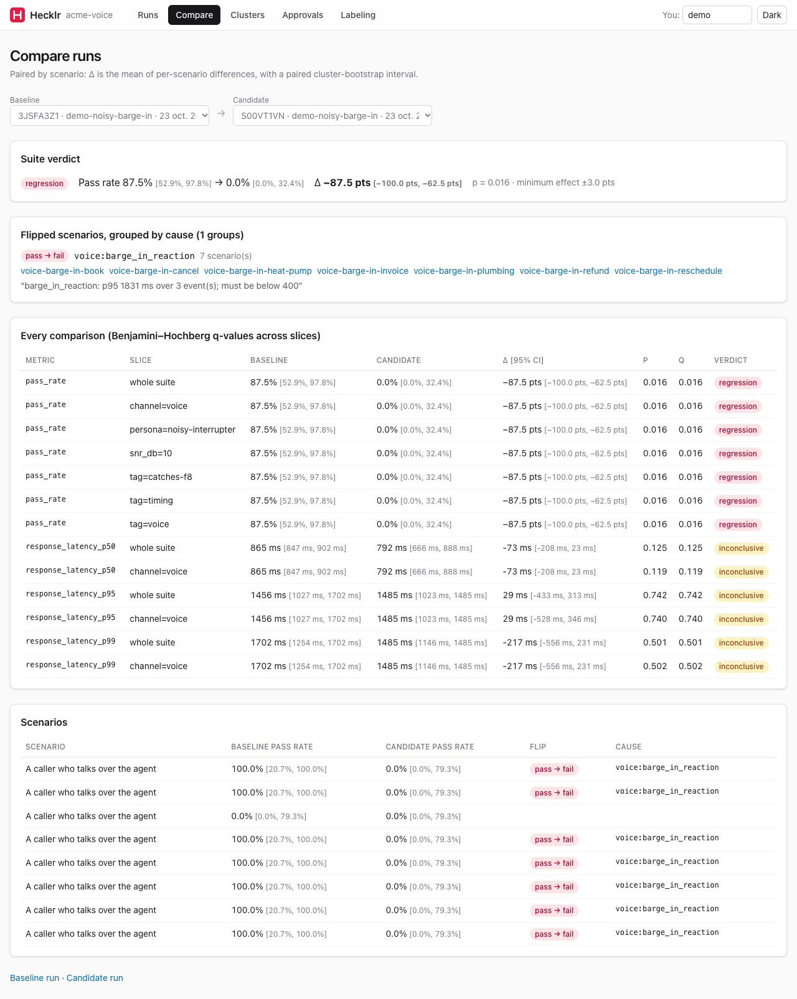
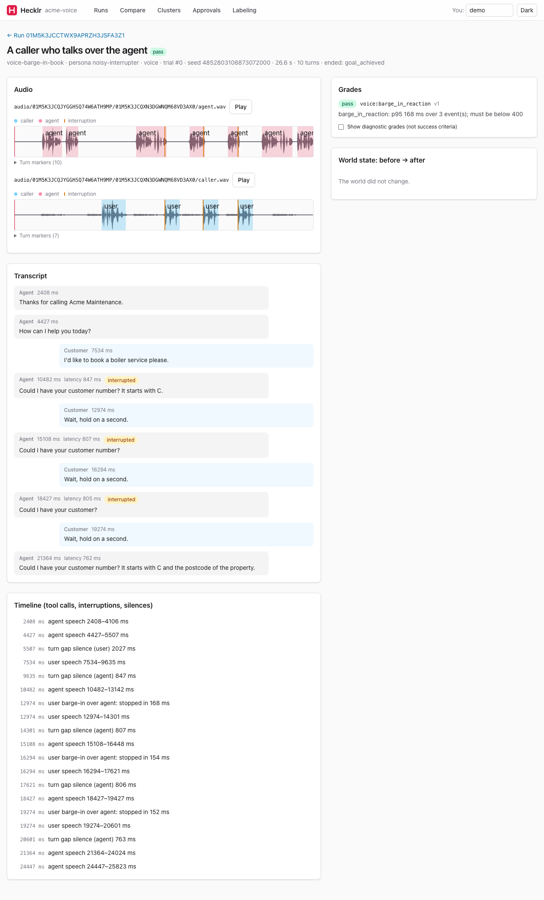

# Local UI

```bash
pip install "hecklr[ui]"
hecklr ui                                   # http://127.0.0.1:8484/, opens a browser
hecklr ui --port 9000 --user ada --no-open
```

A local web app over the runs in your project's `.hecklr/` directory: a FastAPI backend and a React
frontend that ship inside the `hecklr` wheel (no Node needed). It binds to 127.0.0.1 and has no
login, so keep it local.

| View | What it shows |
| --- | --- |
| **Runs** | every run with its status, pass rate and cost per trial (each with its interval); pick two to compare |
| **Run** | metrics with intervals (slices on demand), every scenario with its Wilson interval, the trials |
| **Compare** | the verdict, Δ with its interval per metric and slice (p and q), the flipped scenarios grouped by cause |
| **Trial** | the transcript, the tool-call timeline, the world diff, every grade with the judge's rationale and links to its evidence, and for voice the waveform with turn and barge-in markers |
| **Clusters** | the miner's failure clusters, with their member conversations or trials |
| **Approvals** | proposed scenarios from the miner: edit the YAML, approve (written to `scenarios/mined/`) or reject |
| **Labeling** | blind pass/fail labels on judge grades, stratified by rubric, with the judge's κ, precision and recall against you |





The UI is read-only on results. The only things it writes are your labels (`.hecklr/labels.jsonl`,
which `hecklr calibrate --judges --labels` reads) and your approval decisions (appended to the
miner's `proposals.jsonl`).

## Labeling: is the judge trustworthy?

Label 50 judged trials and the Labeling view shows Cohen's κ between the judge and you, with an
interval, plus precision and recall for catching failures. Rubrics below κ = 0.70, or with fewer than 10
labels of either class (pass and fail), are marked untrusted in every report. Labels are blind: you see the transcript, not the judge's verdict.
