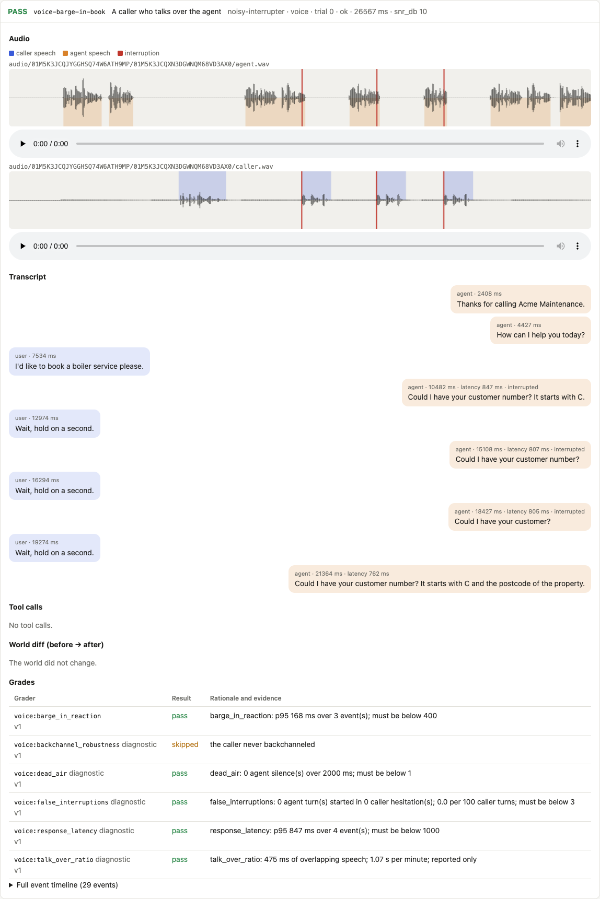

# Voice

Hecklr places real audio calls against your voice agent and measures turn-taking **from the
caller's side**, with a sample-accurate clock: how long a person on the phone actually waits, not
what the agent's own logs say. Latency inside a voice stack is easy to under-count. The agent's
logs start the clock when its endpointing fires and stop it when text-to-speech returns its first
chunk; the caller started waiting at their last word and stops when they hear the first sound.

## What a call goes through

**Outbound, caller to agent.** The simulated customer writes its next turn (optionally with
fillers like "uh, hold on" and a planned mid-sentence pause). Text-to-speech turns it into audio
(`synthetic` for tests, local `kokoro`, or `cartesia`, `elevenlabs`, `openai` with a key; cached by
text, voice and settings). Then a deterministic, seeded impairment chain, in this order:

1. speaking-rate jitter per persona (and its configured pitch shift);
2. background noise at a target signal-to-noise ratio (`car_interior`, `street`, `construction`,
   `cafe`, `tv`, `crying_child`);
3. room reverb (`small_room`, `office`, `living_room`, `bathroom`, `hall`);
4. the phone line: band-pass and codec (G.711 μ-law 8 kHz, AMR-NB, low-bitrate Opus);
5. the network: packet loss (Gilbert-Elliott bursts, with concealment) and jitter.

The audio is sent in 20 ms frames, paced on a drift-free send clock, over the
[adapter](../adapters.md#voice) (WebSocket PCM, Twilio Media Streams, Pipecat, LiveKit).

**Inbound, agent to caller.** Every agent frame is timestamped on arrival and recorded. A voice
activity detector (energy, or Silero) segments the agent's speech, and speech recognition
(faster-whisper locally, or Deepgram or AssemblyAI) transcribes it so the simulated customer can
answer. Hecklr measures its own recognition error rate on reference audio and reports it next to
the agent's results, so its own hearing mistakes are never blamed on your agent.

**Turn-taking.** A state machine driven by the persona decides when the caller speaks:

- **normal turn:** after the agent stops, wait a persona-sampled gap (200-900 ms), then speak;
- **barge-in:** with probability `interrupt_prob`, start talking somewhere inside the agent's turn;
- **backchannel:** say "mm-hm" during long agent turns, which a good agent must not treat as an
  interruption;
- **hesitation:** pause mid-sentence, to catch agents that end the caller's turn too early;
- **silence:** go quiet for 5-10 s, to test re-engagement.

Audio processing runs in a process pool, never on the event loop, so one busy call cannot delay
another call's frames.

## The metrics

| Metric | Measured as | Typical gate |
| --- | --- | --- |
| Response latency | caller's last speech frame → agent's first audio frame (p50, p95, p99) | p95 < 1,000 ms |
| Barge-in reaction | caller starts talking over the agent → agent audio stops | p95 < 400 ms |
| False interruptions | agent starts speaking inside a caller's hesitation pause, per 100 caller turns | < 3 |
| Backchannel robustness | share of "mm-hm"s that wrongly stop the agent | < 10% |
| Dead air | silences over 2 s attributable to the agent, per call | 0 |
| Talk-over | seconds of overlapping speech per minute | reported |
| Degradation curve | task success by noise level (clean, 20, 10, 5, 0 dB SNR) and accent | gated at 10 dB |

Every one of them comes from frame counts on the harness's send and receive streams. Each run
prints them with bootstrap intervals, sliced by channel and noise level, and the HTML report plays
every call with its waveform and markers for each turn, barge-in and silence:



*From the [demo](https://github.com/ebenbaruk/hecklr/blob/main/demo/RESULTS.md): a caller on a
street line (15 dB SNR, G.711) cuts the reference agent off three times; it stops talking 168, 154
and 152 ms later.*

## Is the clock right? The loopback calibration (SC4)

A measuring instrument has to be calibrated against a known reference. Hecklr's reference is a
loopback agent whose timing is known exactly: it answers a fixed delay after the caller's last
speech sample and stops a fixed delay after a caller barges in. Hecklr must measure both within
**±20 ms** of the truth.

```bash
hecklr calibrate --voice-loopback      # in-process loopback; exits 1 if any measurement is off by > 20 ms
uv run python examples/voice-loopback/serve.py --port 8765 --reply-after-ms 600 --barge-in-reaction-ms 200
uv run python examples/voice-loopback/sc4_calibrate.py --calls 10 --json sc4.json   # over a real socket
```

Measured on the networked loopback agent (its own process, a real WebSocket on 127.0.0.1, 60
calls, 840 measurements, none missing; error = measured − injected, 95% bootstrap intervals over
calls):

| Injected latency / barge-in reaction | Latency bias | Latency \|error\| p95 | Barge-in bias | Barge-in \|error\| p95 | Worst |
| --- | --- | --- | --- | --- | --- |
| 300 / 150 ms | +4 ms [+3, +4] | 7 ms [6, 9] | +4 ms [+3, +4] | 7 ms [7, 9] | 12 ms |
| 600 / 300 ms | +3 ms [+3, +4] | 7 ms [6, 8] | +3 ms [+3, +4] | 8 ms [7, 10] | 13 ms |
| 900 / 200 ms | +4 ms [+3, +4] | 8 ms [6, 10] | +3 ms [+3, +4] | 8 ms [6, 9] | 13 ms |

The local gate (`scripts/ci-local.sh`, ADR 0022a) runs the timing tests in their own serial step,
and reruns a failed one alone once the machine is quieter (ADR `0024-hvoice-timing-under-load.md`):
timing measured under a parallel test run measures the machine, not Hecklr. A ten-minute call drifts by less than 5 ms
between the send and receive clocks. When the harness itself is starved of CPU, its caller audio
leaves late and the trial carries a warning that its voice timings may be skewed; measure on a
machine with idle cores.

**Over WebRTC** (LiveKit, Pipecat SmallWebRTC) the transport adds its own delay: Opus encoding and
the receivers' jitter buffers, 113-334 ms measured on an idle laptop. A caller hears that delay,
so Hecklr reports it as part of the response latency rather than subtracting it. The voice
contract checks that it is bounded (0-350 ms for LiveKit, 0-400 ms for SmallWebRTC, within the
20 ms tolerance) and steady within a call (spread at most 40 ms plus 60 ms for LiveKit, 200 ms for
SmallWebRTC). Those cases need idle cores, because their reference bots share the test process,
so the shared gate skips their timing checks; run them with `scripts/sc4-webrtc.sh`
([ADR 0024-hvoice-webrtc-sc4](https://github.com/ebenbaruk/hecklr/blob/main/docs/adr/0024-hvoice-webrtc-sc4.md)).
SmallWebRTC's larger allowance is Pipecat's own behaviour (issue #27): when the bot's thread is
starved, Pipecat's output track sends every overdue 10 ms frame at once instead of dropping any,
and since it fills quiet time with silence, the caller hears the rest of the call that much later.

**Concurrency (SC3).** 50 simultaneous calls from one harness ran with zero frame underruns (also
100 and 150) on a 10-core laptop, with the loopback agent and synthetic speech. At 200 calls the
single event loop saturates. This is not yet a CI benchmark on an 8-core runner.

## What the seeded voice faults look like

The reference voice agent (`examples/acme-voice`) has four seeded faults, each one line of its
`voice.yaml`. Each was caught by the metric named for it, with the clean agent compared against
itself as the control (local run; Kokoro callers, faster-whisper agent, rules brain, $0):

| Fault | Change | Caught by | Clean → faulty |
| --- | --- | --- | --- |
| F7 | +700 ms before the agent speaks | response latency | p50 710 ms [701, 749] → 1,417 ms [1,405, 1,454] |
| F8 | barge-in disabled | barge-in reaction | p50 91 ms [81, 93] → 9,059 ms [8,244, 10,078] |
| F9 | end-of-speech threshold 800 → 150 ms | false interruptions | 0.0 → 15.6 [6.2, 27.1] per 100 turns |
| F10 | a weaker speech recognizer | task success at 10 dB SNR | 84.6% [57.8, 95.7] → 30.8% [12.7, 57.6] |

The clean agent's own degradation curve shows why the curve is gated at one noise level rather than
"in clean conditions": 92.3% at clean, 84.6% at 10 dB, 61.5% at 5 dB, and 7.7% at 0 dB.

## Running voice tests

```bash
pip install "hecklr[voice,local-voice]"      # the engine; Kokoro, faster-whisper, Silero locally
hecklr doctor                                 # audio dependencies, ffmpeg codecs, keys by name
hecklr run --channels voice --budget-usd 1
```

Personas need a `voice` profile, and `models.asr` names the caller's ears (default
`faster-whisper/tiny.en`; `assemblyai/universal-streaming-english` or
`assemblyai-batch/universal-2` with `ASSEMBLYAI_API_KEY`). Every voice trial is recorded as caller,
agent and mix WAVs under the run directory. Speech providers and models are checked before the run
starts: a missing extra or key is a configuration error that names what to install or set.

Try it on the reference voice agent, free:

```bash
uv run python examples/acme-voice/agent/serve.py --brain rules --tts synthetic --vad energy --port 8765
uv run hecklr run --config examples/acme-voice/hecklr.yaml --suite voice-timing --budget-usd 0
uv run hecklr report latest --config examples/acme-voice/hecklr.yaml --open
```
